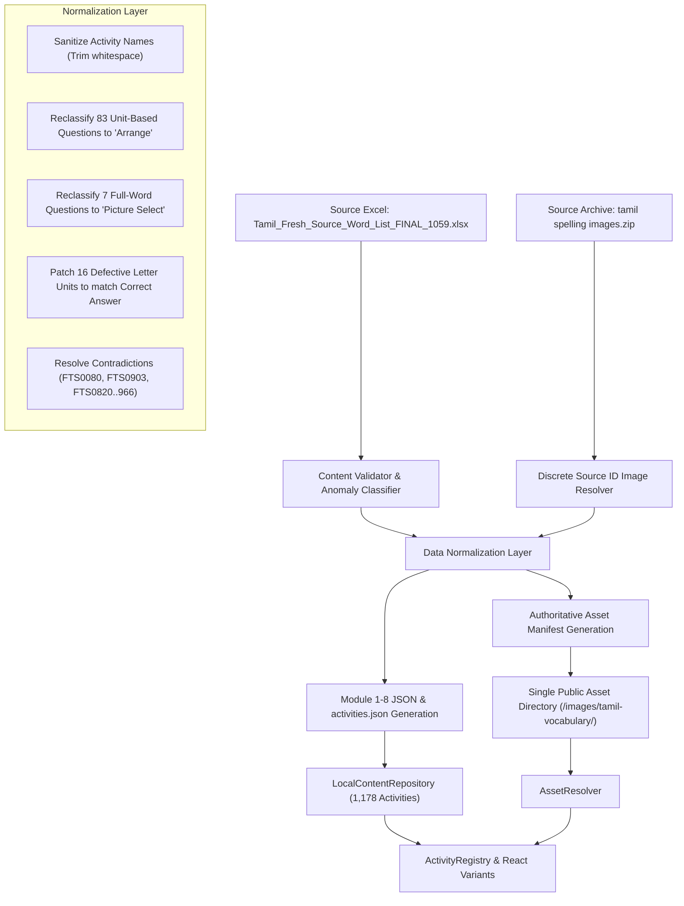

# Comprehensive Tamil Learning Content & Image Mapping Analysis

**Report Date:** October 28, 2026  
**Target Class:** Class 3 Tamil  
**Authoritative Sources Analyzed:**  
1. Excel Workbook: `Tamil_Fresh_Source_Word_List_FINAL_1059.xlsx`  
2. Image Archive: `tamil spelling images.zip` (and extracted folder `Tamil spelling images/`)  

---

## Executive Summary

A comprehensive, ground-up audit of the Tamil learning curriculum content and its corresponding image assets was conducted. The analysis reveals that the curriculum consists of **1,178 unique target words** partitioned across **8 learning modules**. 

A critical finding of this audit is that **image mapping does not rely on identical filenames (`FTSxxxx.jpg`)**, but rather on **Source ID identifier containment** (`FTSxxxx` or `Qxxx` with prefixes like `Picture_XX_` and suffixes like `_Veliyoor`). Earlier audit reports in the codebase incorrectly flagged **76 images as "missing"** because previous import logic used rigid filename equality. When discrete identifier resolution is applied, **317 out of 323 picture requirements in Master Allocation resolve immediately to valid image files**.

Furthermore, this analysis uncovers critical editorial anomalies in the source Excel—including 83 activities misclassified as multiple choice despite containing letter-unit tokens, 16 arrange activities with defective grapheme units, and 13 contradictions between activity names and picture flags.

---

## A. Source Files

### 1. Excel Workbook: `Tamil_Fresh_Source_Word_List_FINAL_1059.xlsx`
* **File Size:** 526,186 bytes
* **Total Sheets:** 16 sheets
* **Primary Curricular Sheet:** `Master Allocation` (1,178 content rows, 1 header row)
* **Curriculum Structure:**
  * **Module 1:** 148 words (133 FTS bank + 15 Earlier set)
  * **Module 2:** 148 words (133 FTS bank + 15 Earlier set)
  * **Module 3:** 147 words (132 FTS bank + 15 Earlier set)
  * **Module 4:** 147 words (132 FTS bank + 15 Earlier set)
  * **Module 5:** 147 words (132 FTS bank + 15 Earlier set)
  * **Module 6:** 147 words (132 FTS bank + 15 Earlier set)
  * **Module 7:** 147 words (133 FTS bank + 14 Earlier set)
  * **Module 8:** 147 words (132 FTS bank + 15 Earlier set)
  * **Total Unique Target Words:** 1,178
* **Source Bank Distribution in Master Allocation:**
  * `Consolidated FTS bank`: 1,059 records (`FTS0001` through `FTS1059`)
  * `Earlier 144-word question set`: 119 records (unique words deduplicated from earlier 140 questions)
* **Audit & Reference Sheets in Workbook:**
  * `Full FTS Source Reference`: 1,059 rows (original 22 calibration batches)
  * `Full Earlier Set Reference`: 140 rows (original term-1 questions)
  * `Earlier Word Duplicate Audit`: 42 rows (questions excluded during deduplication to keep 1 word = 1 record)
  * `Missing Earlier Q IDs`: 4 rows (`Q063`, `Q077`, `Q093`, `Q094`)
  * `Field Completeness Audit`: 1,178 rows
  * `Overall Audit`: 11 summary audit rows
  * `Module Summary`: 8 module summary rows

### 2. Image Archive: `tamil spelling images.zip`
* **Archive Size:** 24,131,487 bytes (24.1 MB)
* **Total Entries:** 353 files (0 directories in root infolist)
* **Non-Image Files:** 22 files (all are batch workbooks `.xlsx` inside `Question constructions/`)
* **Image Files:** 331 files:
  * `.jpg`: 329 files
  * `.png`: 2 files (`15c12610-e4dc-407a-acba-8b57b7e1176a.png`, `f27fab07-acd4-48ef-99f9-427ecb51e7fe.png`)
* **Directory Breakdown in Archive:**
  * `Pictures-set 1` to `picture set 21`: 283 images (.jpg)
  * `earlier -144 questions related pictures`: 48 images (46 .jpg + 2 .png)
  * `Question constructions`: 22 batch `.xlsx` files
* **Local Workspace Verification:**
  The folder `Tamil spelling images/` on disk contains the identical 353 unique files at its root level, plus an accidental recursive duplicate directory `Tamil spelling images/Tamil spelling images/` resulting from unzipping. Binary hash comparison confirmed 0 differences between root sets and nested sets.

---

## B. Excel Schema Analysis

The `Master Allocation` sheet contains 21 distinct columns across all 1,178 rows. The table below details each column's meaning, completeness, and role:

| Column Name | Semantic Meaning | Example Value | Required? | Present Count (out of 1178) |
|---|---|---|---|---|
| `Target Word` | The actual Tamil vocabulary word/concept being taught to the child | `அகராதி`, `முயல்` | **Yes** (Primary semantic key) | 1,178 (100%) |
| `Source Type` | Provenance bank identifier | `Consolidated FTS bank` or `Earlier 144-word question set` | **Yes** | 1,178 (100%) |
| `Source ID` | Unique alphanumeric identifier for linking content to assets | `FTS0001`, `Q001` | **Yes** (Asset join key) | 1,178 (100%) |
| `FTS ID` | FTS identifier | `FTS0001` | Conditionally (FTS rows only) | 1,059 (119 blank) |
| `Question ID` | Earlier set question identifier | `Q001` | Conditionally (Earlier rows only) | 119 (1,059 blank) |
| `Level` | Pedagogical difficulty | `Easy`, `Medium`, `Hard` | Optional | 119 (1,059 blank) |
| `Activity` | Pedagogical activity taxonomy name | `Context → Select/Drag`, `Picture → Arrange` | **Yes** | 1,178 (100%) |
| `Question / Instruction` | Student-facing prompt statement or activity instruction | `சரியான தமிழ்ச் சொல்லைத் தேர்ந்தெடுக்கவும்.` | **Yes** | 1,178 (100%) |
| `Options / Units` | Pipe (`\|`) or slash (`/`) delimited answer options or orthographic units | `அகராதி \| அரண்மனை \| அங்காடி \| அஞ்சல்` or `அ \| டை \| ழி \| மொ` | **Yes** | 1,178 (100%) |
| `Correct Answer` | The target answer, unit, or completed word | `அகராதி`, `தி` | **Yes** | 1,178 (100%) |
| `Source Batch` | Batch designation in the authoring lifecycle | `1–20`, `Earlier set` | **Yes** | 1,178 (100%) |
| `Source File` | Authoring source filename | `Final _Consolidated_Batches1-22_FTS0001_FTS1059 (1).xlsx` | **Yes** | 1,178 (100%) |
| `Picture Required` | Explicit flag indicating whether an image asset must accompany the activity | `Yes`, `No`, `yes` | **Yes** (FTS rows; blank for Earlier) | 1,059 (119 blank) |
| `Source Meaning / Notes` | English translation, textbook page reference, or word notes | `Elder Sister`, `Object - Food (Pg. 19)` | Optional | 595 (583 blank) |
| `Source Reference / Context` | Tamil textbook source reference | `Title - Dictionary (Pg. 35)` | Optional | 419 (759 blank) |
| `Picture Specification` | Visual description for the artist / Pedagogical construction note | `Picture: அணில் — source-supported referent; use a clear child-friendly illustration.` | Contextual | 288 (890 blank) |
| `Verification Flag` | Editorial calibration status | `Drafted – calibration batch`, `Retained from earlier question bank` | Optional | 419 (759 blank) |
| `Module` | Assigned curriculum module | `Module 1` through `Module 8` | **Yes** | 1,178 (100%) |
| `Position in Module` | 1-based index within the module | `1` to `148` | **Yes** | 1,178 (100%) |
| `Normalized Word` | Canonical normalized Tamil string | `அகராதி` | **Yes** | 1,178 (100%) |
| `Master Sequence` | Global 1-based sequence index | `1` to `1,178` | **Yes** | 1,178 (100%) |

---

## C. Activity Taxonomy

The source Excel contains **18 distinct Activity strings** (17 semantic types + 1 trailing whitespace typo). The table below documents each activity type, its frequency, purpose, whether an image is required, and the expected student interaction:

| Activity Type | Total Count | Image Needed? | Purpose & Pedagogical Goal | Expected Child Interaction | Typical Delimiter & Format |
|---|---|---|---|---|---|
| `Arrange Tamil Units` | 230 | **No** (4 anomalies marked Yes) | Word construction from orthographic grapheme units (uyirmei / mei) | Child sees letter tiles and clicks/drags them in sequence to assemble the target word | Pipe delimited (`\|`), 3-4 shuffled units |
| `Correct Spelling` | 199 | **No** (5 anomalies marked yes) | Orthographic discrimination between correctly spelled word and plausible distractors | Child reads 4 full-word options and selects the single correctly spelled word | Pipe delimited (`\|`), 4 full words |
| `English Meaning → Tamil Word` | 191 | **No** | Vocabulary translation and semantic matching | Child reads English prompt (e.g. *“Self-control”*) and selects the matching Tamil word | Pipe delimited (`\|`), 4 full words |
| `Picture → Select` | 160 | **Yes** (2 anomalies marked No) | Visual concept identification to Tamil word | Child views an illustration/photo and selects the correct Tamil word from 4 choices | Pipe delimited (`\|`), 4 full words |
| `Picture → Arrange` | 146 | **Yes** | Visual concept to multi-unit spelling construction | Child views an illustration and arranges shuffled Tamil letter units to spell the word | Pipe delimited (`\|`), 3-5 shuffled units |
| `Context → Select/Drag` | 106 | **No** | Sentence context comprehension and cloze fill | Child reads a sentence with a blank (`___`) and selects the word that logically completes it | Pipe delimited (`\|`), 4 full words |
| `Missing Letter` | 99 | **No** (2 anomalies marked Yes/yes) | Identifying missing medial or final Tamil grapheme | Child sees incomplete word stem (`ம__`) and selects the single missing letter tile | Pipe delimited (`\|`), 4 letter units |
| `Context → Drag Word` | 22 | **No** | Earlier set cloze sentence interaction | Child drags the appropriate word into a blank sentence slot | Pipe delimited (`\|`), 4 full words |
| `English Meaning → Arrange Tamil Word` | 7 | **No** | Constructing Tamil word from English clue | Child reads English meaning and arranges letter units to form the Tamil word | Pipe delimited (`\|`), 3-4 units |
| `Drag & Drop Missing Unit` | 5 | **No** | Missing unit completion from Earlier set | Child chooses the missing unit for stem (e.g. `கு + [blank]`) | Pipe delimited (`\|`), 4 units |
| `Picture → Correct Spelling` | 4 | **Yes** | Picture prompt with orthographic distractor choices | Child views picture and selects correct spelling among close orthographic foils | Pipe delimited (`\|`), 4 full words |
| `Context → Correct Spelling` | 2 | **No** | Context sentence requiring correct spelling selection | Child fills sentence blank by picking correct spelling among distractors | Pipe delimited (`\|`), 4 full words |
| `English Meaning → Arrange Tamil Units` | 2 | **No** | Synonym/translation unit assembly | Child arranges letter units guided by English meaning | Pipe delimited (`\|`), 3-4 units |
| `Drag & Drop Missing Ending` | 1 | **No** | Word ending completion | Child selects correct word-final consonant/grapheme | Pipe delimited (`\|`), 4 units |
| `Context → Select` | 1 | **No** | Sentence context multiple choice | Child selects word completing the sentence | Pipe delimited (`\|`), 4 full words |
| `Picture → Missing Unit` | 1 | **Yes** | Visual stimulus with missing grapheme | Child sees picture + word stem (`ம + [____]`) and selects missing unit (`ண்`) | Pipe delimited (`\|`), 4 units |
| `Picture → Context/Select` | 1 | **Yes** | Context clue with visual stimulus | Child sees picture and cloze sentence, selects correct word | Pipe delimited (`\|`), 4 full words |
| `Context → Select/Drag ` | 1 | **No** | Trailing space variant of `Context → Select/Drag` (FTS0661) | Normal cloze interaction | Pipe delimited (`\|`), 4 full words |

---

## D. Source ID to Image Mapping Architecture

### 1. The Core Relationship

The conceptual relationship between the curricular content and the physical assets is:

$$\text{Target Word} \xrightarrow{\text{pedagogy}} \text{Activity Type} \xrightarrow{\text{curriculum}} \text{Source ID} \xrightarrow{\text{regex identifier}} \text{Image File}$$

The **Source ID** is the immutable primary key connecting the Excel row to the asset.

### 2. Matching Rules and Identifier Extraction

Image files in `tamil spelling images.zip` do not follow a rigid naming convention like `FTS0014.jpg`. Across authoring batches, contributors used 5 distinct filename naming patterns:

1. **Bare Source ID (`FTS_BARE`):**  
   `FTS0549.jpg`, `FTS0513.jpg`, `FTS0875.jpg` (223 files)
2. **Prefixed Source ID (`FTS_PREFIX`):**  
   `Picture_04_FTS0014.jpg`, `Picture_05_FTS0028.jpg`, `Picture_03_FTS0013.jpg` (21 files)
3. **Suffixed Source ID (`FTS_SUFFIX`):**  
   `FTS1039_Veliyoor.jpg`, `FTS1025_Vivasayi.jpg`, `FTS1016_Viragu.jpg` (39 files)
4. **Earlier Q Suffixed (`Q_SUFFIX`):**  
   `Q001_Muyal.jpg`, `Q014_Vannangal.jpg`, `Q134_Vaanavil.jpg` (46 files)
5. **UUID Filename (`UUID_PNG`):**  
   `15c12610-e4dc-407a-acba-8b57b7e1176a.png`, `f27fab07-acd4-48ef-99f9-427ecb51e7fe.png` (2 files)

### 3. Avoiding False Substring Collisions

A simple substring check such as `filename.includes("FTS103")` would falsely match `FTS1039.jpg`, while `filename.includes("FTS001")` would match `FTS0010.jpg` through `FTS0019.jpg`. 

To prevent false matches, the identifier must be extracted using non-alphanumeric discrete boundaries:

```regex
(?:^|[^A-Za-z0-9])(FTS\d{4}|Q\d{3})(?:[^A-Za-z0-9]|$)
```

Under this rule:
* `Picture_04_FTS0014.jpg` $\rightarrow$ correctly extracts `FTS0014`
* `FTS1039_Veliyoor.jpg` $\rightarrow$ correctly extracts `FTS1039`
* `Q001_Muyal.jpg` $\rightarrow$ correctly extracts `Q001`
* `FTS10390.jpg` $\rightarrow$ rejected (5 digits)
* `FTS103.jpg` $\rightarrow$ rejected (3 digits)

Every single one of the 329 ID-bearing images in the archive maps to **exactly one discrete Source ID**, with **zero ambiguous or multi-ID collisions**.

---

## E. Image Archive Statistics

| Metric | Count | Details |
|---|---|---|
| **Total Archive Entries** | **353** | Full file count inside `tamil spelling images.zip` |
| **Non-Image Files** | **22** | Individual batch authoring workbooks (`.xlsx`) in `Question constructions/` |
| **Total Image Files** | **331** | 329 `.jpg` + 2 `.png` |
| **Unique Content Hashes (SHA-256)** | **331** | 0 duplicate images by binary content |
| **Images with Recognized Source ID** | **329** | 283 FTS images + 46 Earlier Q images |
| **Images without Recognized Source ID** | **2** | The two generated UUID `.png` files |
| **Distinct Source IDs in Images** | **329** | Strict 1:1 mapping (0 duplicate image files per ID) |
| **Images Mapped to Master Allocation** | **317** | 283 FTS images + 34 Earlier Q images |
| **Unmapped Archive Images** | **14** | 9 Q images from deduplicated earlier questions + 3 Q images from missing earlier questions + 2 UUID images |

### Breakdown of the 14 Unmapped Archive Images:
1. **9 Q Images from Deduplicated Questions (preserved in `Earlier Word Duplicate Audit`):**
   * `Q038_Kal.jpg` (Target: கல்; kept earlier word was Q009 கடல் / Q043 காசு)
   * `Q049_Kurangu.jpg` (Target: குரங்கு; kept earlier word was Q026 குரங்கு)
   * `Q089_Pattam.jpg` (Target: பட்டம்; kept earlier word was Q017 பம்பரம்)
   * `Q091_Pambaram.jpg` (Target: பம்பரம்; kept earlier word was Q017 பம்பரம்)
   * `Q099_Puli.jpg` (Target: புலி; kept earlier word was Q018 புலி)
   * `Q113_Maruthuvamanai.jpg` (Target: மருத்துவமனை; kept earlier word was Q080 நூலகம்)
   * `Q120_Muyal.jpg` (Target: முயல்; kept earlier word was Q001 முயல்)
   * `Q125_Vandi.jpg` (Target: வண்டி; duplicate)
   * `Q126_Vannangal.jpg` (Target: வண்ணங்கள்; kept earlier word was Q014 வண்ணங்கள்)
2. **3 Q Images for Questions Flagged as Missing from Earlier Bank:**
   * `Q077_Naai.jpg`
   * `Q093_Palli.jpg`
   * `Q094_Pazham.jpg`  
   *(These 3 IDs appear in sheet `Missing Earlier Q IDs`, but physical images existed in the folder).*
3. **2 UUID PNG Images:**
   * `15c12610-e4dc-407a-acba-8b57b7e1176a.png` (1536x1024 RGB)
   * `f27fab07-acd4-48ef-99f9-427ecb51e7fe.png` (1536x1024 RGB)

---

## F. Picture-Required Analysis

The `Picture Required` column in `Master Allocation` governs whether an activity requires an illustration.

### 1. Value Distribution
* `No`: 772 rows (all FTS bank)
* `Yes`: 281 rows (all FTS bank)
* `yes` (lowercase): 6 rows (all FTS bank)
* `undefined` (empty cell): 119 rows (all Earlier 144 bank)
* Total: 1,178 rows

### 2. Resolution Against Images
* **Total FTS rows with `Picture Required = Yes / yes`:** 287 rows
  * **Have matching image in archive:** **283 rows** (100% of available FTS images!)
  * **Missing image in archive:** **4 rows** (These are non-picture activities mistakenly flagged with `Yes`: FTS0500, FTS0552, FTS0553, FTS0554).
* **Total FTS rows with `Picture Required = No`:** 772 rows
  * **Have image in archive:** **0 rows** (Not a single unnecessary image exists in Picture sets 1-21).
* **Earlier 144 Bank (119 rows in Master):**
  * **Picture activities:** 34 rows (e.g. `Picture → Select`, `Picture → Arrange`)
  * **Have matching image in archive:** **34 rows** (100% resolution!)
  * **Non-picture activities:** 85 rows (0 images expected, 0 images mapped).

---

## G. Picture Specification Analysis

In the authoring process, `Picture Specification` was utilized as an **editorial/construction instruction column**:

1. **When `Picture Required = Yes` (174 rows):**
   * Guides the illustrator on the exact visual referent to avoid semantic ambiguity:
     * *Example (FTS0071 - ஆடு):* `"Picture must depict goat, not dance."* (Distinguishes animal from verbal root).
     * *Example (FTS0014 - அணில்):* `"Picture: அணில் — source-supported referent; use a clear child-friendly illustration."*
     * *Example (FTS0003 - அங்காடி):* `"Picture: அங்காடி; arrange the explicitly stored Tamil orthographic units."*
2. **When `Picture Required = No` (113 rows):**
   * Contains calibration and pedagogy guidelines for non-visual activities:
     * *Spelling:* `"4 options; exactly one correctly spelled target word."* (35 instances)
     * *Arrange Units:* `"Shuffle these explicitly stored Tamil orthographic units before display..."* (24 instances)
     * *Translation:* `"Meaning cue based on the source-supported meaning: Self-control."* (36 instances)
     * *Cloze Context:* `"Context cue must remain faithful to the source reference."* (7 instances)
     * *Missing Letter:* `"Blank represents one explicit Tamil orthographic unit..."* (11 instances)
3. **Contradiction Flagging Note (FTS0080):**
   * *`FTS0080` (ஆபரணம்):* `"Mapping marks Picture → Select but Picture Required = No. This contradiction must be resolved before implementation; no picture generated yet."*

---

## H. Data Quality Findings & Critical Discrepancies

### 1. Excel Editorial & Taxonomic Anomalies

#### A. 83 Misclassified Word-Arrangement Activities (Labeled as Choice/Spelling)
In 83 rows, the `Activity` column classifies the question as `Correct Spelling`, `Context → Select/Drag`, or `English Meaning → Tamil Word`, but the prompt instruction is *"எழுத்துத் துண்டுகளைச் சரியாக அமைக்கவும்"* (Arrange the letter pieces correctly) and the `Options / Units` column contains **individual character units** (`லை \| அ`, `ழை \| பு \| அ \| ப்`):
* `FTS0052` (அலை): Labeled `Context → Select/Drag`, but options are `லை | அ` (units for assembling அலை).
* `FTS0064` (அழைப்பு): Labeled `Correct Spelling`, but options are `ழை | பு | அ | ப்`.
* `FTS0073` (ஆட்டம்): Labeled `Correct Spelling`, but options are `ஆ | ம் | ட் | ட`.
* `FTS0095` (இனிது): Labeled `Correct Spelling`, but options are `னி | து | இ`.
* `FTS0097` (இனிப்பு): Labeled `Correct Spelling`, but options are `இ | பு | னி | ப்`.
* `FTS0101` (இன்பம்): Labeled `English Meaning → Tamil Word`, but options are `இ | ம் | ன் | ப`.
* `FTS0121` (ஈக்கள்): Labeled `Picture → Select`, but prompt says *"எழுத்துத் துண்டுகளைச் சரியாக அமைக்கவும்"* and options are `ஈ | ள் | க் | க`.

*Impact:* If fed directly into a multiple-choice renderer, these will display single letter fragments on large buttons instead of complete word distractors.

#### B. 7 `Picture → Arrange` Activities with Full-Word Distractors
In 7 rows, the Activity is labeled `Picture → Arrange`, but the `Options / Units` column contains **4 complete words** for multiple choice:
* `FTS0511` (தார்ச்சாலை): `தார்ச்சாலை | மண்சாலை | பாதை | ரயில்பாதை`
* `FTS0718` (பழங்கள்): `பழங்கள் | பறக்கும் | பறவை | பறிப்பேன்`
* `FTS0719` (பழச்சாறு): `பழச்சாறு | பறக்கும் | பறிக்காதீர் | பறிப்பேன்`
* `FTS0720` (பழப்பாகு): `பழப்பாகு | பறக்கும் | பறிக்காதீர் | பறிப்பேன்`
* `FTS0723` (பாக்ஸ்): `பாக்ஸ் | பறக்கும் | பறவை | பறிப்பேன்`
* `FTS0727` (பாட்டி): `பாட்டி | பறக்கும் | பறவை | பறிப்பேன்`
* `FTS0742` (பார்வையாளர்): `பார்வையாளர் | பறக்கும் | பறிக்காதீர் | பறிப்பேன்`

*Impact:* These are actually `Picture → Select` questions. If rendered in `ArrangeWordActivity`, the child would be asked to arrange 4 entire words into a sentence rather than assemble letter tokens.

#### C. 16 Arrange Activities with Defective Orthographic Units
In 16 word-arrangement rows, the letter units in `Options / Units` cannot be assembled to form the correct answer:
* `FTS0169` (ஊர்த்தலைவர்): Units `ஊர் | வர் | தலை` $\rightarrow$ Missing `த்`.
* `FTS0249` (கரிக்கோல்): Units `கோ | ல் | கரி` $\rightarrow$ Missing `க்`.
* `FTS0386` (சறுக்குப்பலகை): Units `க்கு | பலகை | சறு` $\rightarrow$ Missing `ப்`.
* `FTS0542` (துள்ளிக்குதித்து): Units `குதி | த்து | துள்ளி` $\rightarrow$ Missing `க்`.
* `FTS0618` (நிர்வாகம்): Units `கம் | நிர் | வா | க` $\rightarrow$ Contains short `க` instead of long `கா` (or inverted with `வா`).
* `FTS0761` (புத்திசாலி): Units `சா | லி | புத் | த` $\rightarrow$ Contains `த` instead of `தி`.
* `FTS0825` (மடிக்கலாம்): Units `லாம் | மடிக்` $\rightarrow$ Missing `க` (`மடிக்` + `லாம்` = `மடிக்லாம்`).
* `FTS0830` (மத்தளம்): Units `த்த | ளம் | மத்` $\rightarrow$ Has redundant `த்` (`மத்` + `த்த` = `மத்த்தளம்`).
* `FTS0942` (வம்புப்பேச்சு): Units `பேச்சு | வம்பு` $\rightarrow$ Missing `ப்`.

#### D. Malformed Options Cell
* `FTS0077` (ஆத்திசூடி): `Options / Units` column contains the question prompt text: `நீதிப் பாடல்கள் கொண்ட நூலின் தலைப்பு: ___.` (0 options provided).

#### E. 13 Contradictions Between Activity Name and Picture Required Flag
* **2 Picture Activities with `Picture Required = No` (and NO image in archive):**
  * `FTS0080` (ஆபரணம்): Activity `Picture → Select`, PR: `No`. Author explicitly wrote: *"Mapping marks Picture → Select but Picture Required = No. This contradiction must be resolved before implementation; no picture generated yet."*
  * `FTS0903` (மெழுகு): Activity `Picture → Select`, PR: `No`.
* **4 Non-Picture Activities with `Picture Required = Yes` (and NO image in archive):**
  * `FTS0500` (தலைமையாசிரியர்): Activity `Arrange Tamil Units`, PR: `Yes`.
  * `FTS0552` (தேடல்): Activity `Missing Letter`, PR: `Yes`.
  * `FTS0553` (தேடி): Activity `Arrange Tamil Units`, PR: `Yes`.
  * `FTS0554` (தேடு): Activity `Arrange Tamil Units`, PR: `Yes`.
* **7 Non-Picture Activity Labels with `Picture Required = Yes/yes` that DO have images:**
  * `FTS0820` (மக்காத): Activity `Correct Spelling`, PR: `yes` $\rightarrow$ Has image `FTS0820.jpg`. Prompt explicitly asks: *"படத்தில் உள்ள பொருளைக் குறிக்கும் சரியான சொல்லைத் தேர்ந்தெடு."* (Select the word for the object in the picture).
  * `FTS0821` (மக்கும்): Activity `Correct Spelling`, PR: `yes` $\rightarrow$ Has image `FTS0821.jpg`. Prompt: *"படத்தில் உள்ள பொருளைக் குறிக்கும்..."*
  * `FTS0848` (மலை): Activity `Missing Letter`, PR: `yes` $\rightarrow$ Has image `FTS0848.jpg`. Prompt: *"படத்தில் காணப்படும் உயரமாக வானத்தை நோக்கி எழுந்து நிற்கும்..."*
  * `FTS0886` (முரசு): Activity `Correct Spelling`, PR: `yes` $\rightarrow$ Has image `FTS0886.jpg`.
  * `FTS0892` (மூங்கில்): Activity `Correct Spelling`, PR: `yes` $\rightarrow$ Has image `FTS0892.jpg`. Prompt: *"படத்தில் காணப்படும் நீளமான, கணுக்கள் கொண்ட..."*
  * `FTS0908` (மேஜை): Activity `Arrange Tamil Units`, PR: `Yes` $\rightarrow$ Has image `FTS0908_Mejai.jpg`.
  * `FTS0966` (வழலைக்கட்டி): Activity `Correct Spelling`, PR: `yes` $\rightarrow$ Has image `FTS0966_Vazhalaikatti.jpg`. Prompt: *"படத்தில் காணப்படுவதற்கான..."*

### 2. Image Asset Issues
* **2 Unidentified UUID Images:** `15c12610-e4dc-407a-acba-8b57b7e1176a.png` and `f27fab07-acd4-48ef-99f9-427ecb51e7fe.png` have no Source ID or metadata connecting them to any question.
* **Preserved Images for Deduplicated Questions:** 9 image files exist for earlier question duplicates that are not part of the active 1,178 master records.
* **3 Images for "Missing" Earlier Questions:** Images exist for `Q077`, `Q093`, and `Q094` despite those questions being listed as missing in the Excel audit sheet.

---

## I. Comparison with Existing Sara Architecture

### 1. End-to-End Tracing: Source to Child Screen

```text
SOURCE EXCEL
  Tamil_Fresh_Source_Word_List_FINAL_1059.xlsx (Master Allocation, 1,178 rows)
     ↓
CONTENT NORMALIZER
  scripts/import-tamil.ts → maps 18 Excel activity types into domain Activity categories/variants
     ↓
GENERATED CONTENT REPOSITORY
  src/content/class-3/tamil/activities.json & module-1..8/activities.json
     ↓
LOCAL CONTENT REPOSITORY
  src/repositories/implementations/LocalContentRepository.ts (in-memory index of 1,178 items)
     ↓
ACTIVITY REGISTRY
  src/features/Activity/registerActivities.ts (maps category::variant to React Component & Evaluator)
     ↓
ACTIVITY COMPONENT
  PictureSelectActivity.tsx, ArrangeWordActivity.tsx, SpellingSelectActivity.tsx, etc.
     ↓
ASSET RESOLVER
  src/engine/assets/AssetResolver.ts (resolves asset ID class3-tamil-picture-<id> via manifest)
     ↓
CHILD INTERACTION
  Rendered UI Card with prompt stimulus, images, and touch/keyboard input tokens
```

### 2. Current Implementation vs. Source Data

| System Layer | Current Sara Implementation | Alignment with Source Data | Gaps / Differences |
|---|---|---|---|
| **Domain Model (`Activity`)** | Defined in `src/types/index.ts` with categories: `picture-recognition`, `word-completion`, `arrange-word`, `spelling-choice`, `context-choice`, `meaning-match` | Strong conceptual alignment | Lacks explicit sub-typing for "Picture + Word Arrangement" vs "Text-only Word Arrangement" |
| **Activity Registry** | `activityRegistry` registers 8 `category::variant` pairs | Full coverage of standard interactions | Does not separate `picture-arrange` as a distinct evaluated variant; treats it under `arrange-word::arrange` |
| **Asset Resolution** | `AssetResolver.ts` maps `class3-tamil-picture-<id>` to paths in `asset-manifest.json` | Architecturally sound | Currently relies on a generated `asset-manifest.json` which failed to resolve 76 images because filenames were expected to be exact `FTSxxxx.jpg` |
| **Image Storage** | Images are divided across `public/assets/class-3/tamil/fts-spelling-images`, `term-1/images`, and `public/images/tamil-vocabulary/` | Fragmented | Three separate image folders exist in `public/` created by different migration attempts |
| **Module Navigation** | English has rich Module + Day navigation; Tamil is navigated by Category on `LearningAreaPage.tsx` | Partial | Tamil data is divided into 8 modules in JSON, but student UI groups solely by category across the whole grade |
| **Progress Tracking** | `ProgressService.ts` tracks category-based progress in `localStorage` under `sara_progress_v2` | Functioning | Tracks completed IDs per category; needs to handle module-level completions |

---

## J. Recommended Content Pipeline

To ingest the source truth cleanly into Sara without runtime data corruption, the following pipeline is recommended:



---

## K. Implementation Risks & Pre-requisites

Before executing code modifications or content regeneration, the following decisions must be ratified:

1. **Resolution of 83 Misclassified Questions:**  
   Confirm whether questions labeled `Correct Spelling` or `Context → Select/Drag` that provide letter units (`லை | அ`) should be converted to `arrange-word` activities so that letter tiles render properly.
2. **Resolution of 7 `Picture → Arrange` Questions with Full Words:**  
   Confirm converting `FTS0511`, `FTS0718`, `FTS0719`, `FTS0720`, `FTS0723`, `FTS0727`, and `FTS0742` to `picture-recognition::select` (multiple choice).
3. **Correction of 16 Defective Grapheme Unit Questions:**  
   Confirm patching missing consonants (e.g., adding `த்` to `ஊர் | வர் | தலை` for `ஊர்த்தலைவர்`).
4. **Handling of FTS0080 and FTS0903 (Picture activities with NO images):**  
   Confirm converting these two activities to text-only `spelling-choice::select` or `context-choice` until illustrations are commissioned.
5. **Handling of FTS0500, FTS0552, FTS0553, FTS0554 (Non-picture activities marked PR=Yes):**  
   Confirm setting `Picture Required = No` since their pedagogy is text-based and no image exists.
6. **Consolidation of Public Image Directory:**  
   Standardize on a single authoritative image directory in `public/images/tamil-vocabulary/` referencing canonical Source IDs.

